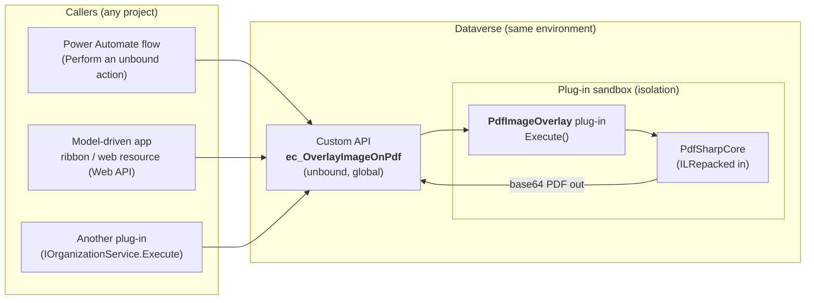
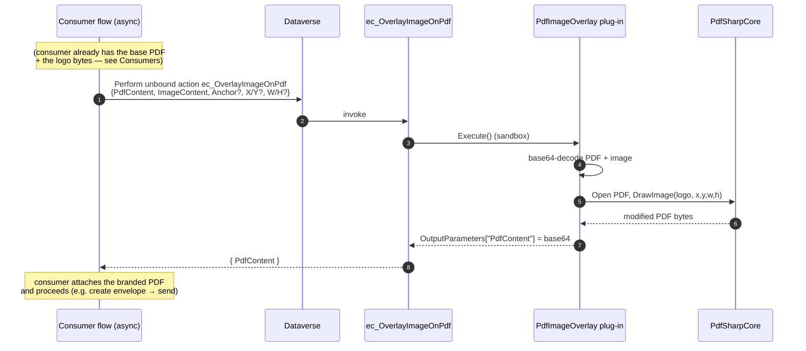

# PdfImageOverlay — a reusable "stamp an image onto a PDF" Dataverse plugin

> **Status: design / developer guide for review. Nothing implemented yet.**
> Full source in [Annex A](#annex-a--full-plugin-source).

A small, **schema-agnostic, fully in-platform** product: a Dataverse **Custom API** that takes a
**PDF + an image** (and optional position / size) and returns a **new PDF with the image stamped
on it**. No Azure, no custom connector, no premium licence — it runs server-side in the Dataverse
plug-in sandbox.

It is distributed as its **own managed solution** so it can be dropped into any environment and
reused by any project (e-signature branding, watermarking, logos, QR codes, signatures, etc.).
The e-signature / political-party use case is just **one consumer** of it (see
[Consumers](#consumers) and the separate web-resource plan).

---

## Contents
- [Why a plugin / Custom API](#why-a-plugin--custom-api)
- [Architecture](#architecture)
- [Sequence (flow invocation)](#sequence-flow-invocation)
- [The Custom API](#the-custom-api-ec_overlayimageonpdf)
- [Parameters & defaults](#parameters--defaults)
- [Example usage](#example-usage)
- [Libraries and why each is needed](#libraries-and-why-each-is-needed)
- [The "three stubs", in the new split design](#the-three-stubs-in-the-new-split-design)
- [Build & package](#build--package)
- [Install guide](#install-guide)
- [Solution information page](#solution-information-page)
- [Versioning & distribution (as a product)](#versioning--distribution-as-a-product)
- [Testing](#testing)
- [Limits & sandbox constraints](#limits--sandbox-constraints)
- [Consumers](#consumers)
- [Annex A — full plugin source](#annex-a--full-plugin-source)
- [Annex B — Custom API definition & registration](#annex-b--custom-api-definition--registration)
- [Annex C — solution information page (sample HTML)](#annex-c--solution-information-page-sample-html)

---

## Why a plugin / Custom API
- **In-platform:** runs inside Dataverse. No Azure Function, no hosting, no custom-connector
  licence. PDF manipulation can't be done in a vanilla cloud flow, and Power Automate has no
  Node runtime, so the overlay logic lives in **C#** (the equivalent of the `pdf-lib` call).
- **Reusable:** exposed as an **unbound Custom API** that takes/returns base64 strings — it touches
  no tables and knows nothing about e-signatures or PPEP. Any flow, plug-in, or web resource can
  call it.
- **Portable:** shipped as its own **managed** solution → import once per environment.

---

## Architecture



The plug-in is a pure function: **`(pdfBase64, imageBase64, position?, size?) → pdfBase64`**. It
makes **no Dataverse reads/writes**, so it's safe, fast, and reusable.

---

## Sequence (flow invocation)

Here the consumer is the e-signature flow, but the Custom API part is identical for any caller.



---

## The Custom API: `ec_OverlayImageOnPdf`

| | |
|---|---|
| **Unique name** | `ec_OverlayImageOnPdf` *(swap `ec_` for your publisher prefix)* |
| **Binding** | **Unbound** (global) — not tied to any table |
| **Type** | Custom API backed by the `PdfImageOverlay` plug-in |
| **Execute privilege** | None required beyond calling it (it reads/writes no data) |
| **Allowed callers** | Flows (Dataverse connector), JS web resources (Web API), other plug-ins |

### Parameters & defaults

**Request parameters**

| Name | Type | Required | Default | Description |
|---|---|---|---|---|
| `PdfContent` | String | **Yes** | — | Base64 of the source PDF. |
| `ImageContent` | String | **Yes** | — | Base64 of the image to stamp (**PNG or JPEG**). |
| `Anchor` | String | No | `TopRight` | One of `TopRight`, `TopLeft`, `BottomRight`, `BottomLeft`, `Center`. Ignored if `X`+`Y` are supplied. |
| `X` | Decimal | No | — | Explicit left position in **PDF points, top-left origin**. Overrides `Anchor` when `X`+`Y` both given. |
| `Y` | Decimal | No | — | Explicit top position (points, top-left origin). |
| `Width` | Decimal | No | auto | Target width (points). If only `Width` given, height is derived to keep aspect. |
| `Height` | Decimal | No | auto | Target height (points). If only `Height` given, width is derived to keep aspect. |
| `Margin` | Decimal | No | `24` | Edge margin (points) used for anchored placement. |
| `Page` | Integer | No | `1` | 1-based page to stamp. `0` = **every page**. |

**Response parameters**

| Name | Type | Description |
|---|---|---|
| `PdfContent` | String | Base64 of the resulting PDF (image stamped in). |

### Default behaviour (no position/size given)
- **Position:** top-right corner, `Margin` = 24 pt from the top and right edges.
- **Size:** fit the image inside a box of `clamp(12% of page width, 48pt, 120pt)`, preserving
  aspect ratio. On a 612×792 (US Letter) page that's a ~73 pt box — a sensible logo size.
- **Page:** page 1 only.

Everything is overridable; pass `Anchor`, or exact `X`/`Y`, and `Width`/`Height` to control it.

---

## Example usage

### 1. Power Automate (recommended — "flow invocation")
Add a **Dataverse → "Perform an unbound action"** step:
- **Action Name:** `ec_OverlayImageOnPdf`
- **Parameters (advanced / raw):**
```json
{
  "PdfContent":   "@{outputs('Get_template_PDF')?['body/documentbody']}",
  "ImageContent": "@{base64(body('Download_party_logo'))}",
  "Anchor":       "TopRight"
}
```
- Read the result from `outputs('Perform_an_unbound_action')?['body/PdfContent']`.

### 2. Web API (JS web resource / anywhere)
```http
POST [org]/api/data/v9.2/ec_OverlayImageOnPdf
Content-Type: application/json

{ "PdfContent": "<base64 pdf>", "ImageContent": "<base64 png>", "Anchor": "TopRight" }
```
Response: `{ "PdfContent": "<base64 pdf>" }`.

### 3. Exact placement + custom size
```json
{ "PdfContent":"…","ImageContent":"…","X":430,"Y":30,"Width":120,"Height":40,"Page":1 }
```

### 4. Stamp every page (e.g. a watermark)
```json
{ "PdfContent":"…","ImageContent":"…","Anchor":"Center","Page":0 }
```

---

## Libraries and why each is needed

| Library | Scope | Why |
|---|---|---|
| **Microsoft.CrmSdk.CoreAssemblies** | compile-time | `IPlugin`, `IPluginExecutionContext`, `InputParameters`/`OutputParameters` — the Custom-API plumbing the plug-in implements. |
| **PdfSharpCore** | compile-time + **shipped (ILRepacked)** | Opens/modifies the PDF and does `XGraphics.DrawImage`. **Pure managed** PNG/JPEG decoders — **no `System.Drawing`/GDI**, which is why it works inside the sandbox (classic PdfSharp/iTextSharp-with-GDI would be blocked). |
| **ILRepack** (`ILRepack.Lib.MSBuild.Task`) | build-time only | Merges PdfSharpCore (+ its deps) **into the single signed plug-in DLL** — the sandbox loads only one assembly. |
| *(no JSON library)* | — | Parameters are strongly-typed Custom-API inputs, so no `cs_templatejson` parsing happens here (that's a consumer concern). |

---

## The "three stubs", in the new split design

The earlier `SendBrandedEnvelopePlugin.cs` had three stubs. With the **agnostic split** they now
live in two places:

| Former stub | Where it lives now | What it does |
|---|---|---|
| **`CompositeLogo`** | **This plug-in** (`PdfImageOverlay.Overlay`) — fully implemented in [Annex A](#annex-a--full-plugin-source) | The only real work: decode PDF+image, compute position/size (anchor/explicit), `DrawImage`, return bytes. Generalised with `Anchor/X/Y/Width/Height/Margin/Page`. |
| **`DownloadFileColumn`** | **Consumer** (the e-sign flow / web resource) | Reads the party logo from `pfa_politicalparty.pfa_logo` (Image column) — `GET pfa_politicalparties(id)/pfa_logo/$value?size=full`. Not the generic plug-in's concern. |
| **`ParseSignerLabels`** | **Consumer** (the e-sign flow / web resource) | Reads `cs_templatejson.signers[].label` to map recipients. Not the generic plug-in's concern. |

This keeps the product a clean, reusable **PDF function**; all e-signature/PPEP specifics are in the
consumer layer.

---

## Build & package
1. **Project:** C# **Class Library targeting .NET Framework 4.6.2** (e.g.
   `plugins/EC.Pdf.Plugins/EC.Pdf.Plugins.csproj`). NuGet: `Microsoft.CrmSdk.CoreAssemblies`,
   `PdfSharpCore`, `ILRepack.Lib.MSBuild.Task`.
2. **Strong-name** the assembly (`.snk`) — required to register.
3. **ILRepack** PdfSharpCore (+ deps) into the output DLL (`Internalize=true`) so the sandbox sees
   one assembly.
4. **Register** (Plugin Registration Tool or `pac plugin push`): assembly **Isolation = Sandbox**,
   **Storage = Database**. Create the **Custom API** `ec_OverlayImageOnPdf` (unbound) with the
   request/response parameters in [Annex B](#annex-b--custom-api-definition--registration) and point
   its plug-in type at `PdfImageOverlay`.
5. **Package** into a dedicated **managed** solution `PdfImageOverlay` (publisher prefix `ec`),
   containing: the plug-in assembly, the Custom API + its parameters, and the information-page web
   resource (Annex C).

---

## Install guide
1. Import `PdfImageOverlay_x_y_z_managed.zip` into the target environment.
2. Open the solution → the **Information page** (Annex C) summarises the Custom API, parameters and
   examples for the installer.
3. The Custom API `ec_OverlayImageOnPdf` is immediately callable from flows, web resources, or
   other plug-ins. No configuration records required.
4. (Optional) Grant the relevant security role the privilege to call the Custom API if you lock it
   down; by default any authenticated caller in the org can invoke it (it reads/writes no data).

---

## Solution information page
Managed solutions don't pop a readme on import, so the "info page the installer reads" is shipped as
an **HTML web resource** (`ec_/pdfoverlay/about.html`, [Annex C](#annex-c--solution-information-page-sample-html))
plus the **Solution Description** field. The page covers: what the Custom API does, the parameter
table, default position/size, a copy-paste flow example, the version, and support contact. You can
surface it via a one-page model-driven app (an "About" area) or just open the web resource URL; its
link goes in the Solution Description so it's discoverable from the Solutions list.

---

## Versioning & distribution (as a product)
- Ship **managed** for distribution; keep an unmanaged dev solution for source.
- Semantic solution version (e.g. `1.0.0.0`); bump on every release; the info page shows the version.
- Publisher prefix is yours (`ec`); the Custom API name carries it, so it won't clash.
- Promote dev → test → prod by exporting managed and importing; no data/config to migrate.

---

## Testing
- **Offline unit test** the `Overlay` method: feed a sample PDF + PNG/JPEG, assert the output opens
  and the image lands at the expected rectangle for each `Anchor` and for explicit `X/Y`.
- **In-env:** call `ec_OverlayImageOnPdf` from a scratch flow with a template PDF + a party logo;
  download the `PdfContent` and eyeball it. The Node sample
  `solutions/docs/sample-create-partylogo-envelope.mjs` is the visual reference for the default
  top-right placement.

---

## Limits & sandbox constraints
- **Sandbox isolation:** no filesystem, **no `System.Drawing`/GDI**, approved managed APIs only,
  ~2-minute execution cap. PdfSharpCore + ILRepacked deps comply. **Async** step recommended for
  large PDFs (per your answer #4).
- **One signed assembly:** all deps ILRepacked in.
- **Image formats:** PNG and JPEG (both present in `pfa_logo`); `XImage` handles both.
- **Message size:** base64 PDFs travel in the action payload; very large PDFs increase memory/time —
  prefer async and reasonable document sizes.

---

## Consumers
This product is generic. The **e-signature / political-party** consumer (separate from this solution)
does:
1. Read the registered party's logo from **`pfa_politicalparty.pfa_logo`** (Image column) —
   `GET …/pfa_politicalparties(<id>)/pfa_logo/$value?size=full`.
2. Read the chosen `cs_template`'s `TemplateSourcePDF` + `cs_templatejson`.
3. Call **`ec_OverlayImageOnPdf`** (PDF = template PDF, Image = party logo) → branded PDF.
4. Create `cs_envelope` + `EnvelopeSourcePDF` + signers, set `cs_adhocsend = true`.
5. Broker `ESign - Send Ad-hoc Envelope` (unchanged) submits to Nintex.

Two consumer front-ends:
- **Flow** (answer #2 — flow invocation): the canonical headless path.
- **Model-driven ribbon button + JS web resource** for backend users — see the separate plan
  `solutions/docs/branded-esign-webresource-plan.md`.

---

## Annex A — full plugin source

```csharp
// EC.Pdf.Plugins/PdfImageOverlay.cs
// Custom API plug-in: ec_OverlayImageOnPdf
// Stamps a base64 image onto a base64 PDF and returns the base64 result.
// Schema-agnostic: no Dataverse reads/writes. Sandbox-safe (PdfSharpCore, no GDI).
using System;
using System.IO;
using Microsoft.Xrm.Sdk;
using PdfSharpCore.Drawing;
using PdfSharpCore.Pdf;
using PdfSharpCore.Pdf.IO;

namespace EC.Pdf.Plugins
{
    public class PdfImageOverlay : IPlugin
    {
        public void Execute(IServiceProvider sp)
        {
            var ctx = (IPluginExecutionContext)sp.GetService(typeof(IPluginExecutionContext));
            var trace = (ITracingService)sp.GetService(typeof(ITracingService));
            try
            {
                string pdfB64 = GetString(ctx, "PdfContent", required: true);
                string imgB64 = GetString(ctx, "ImageContent", required: true);
                string anchor = GetString(ctx, "Anchor") ?? "TopRight";
                double? x = GetDouble(ctx, "X");
                double? y = GetDouble(ctx, "Y");
                double? w = GetDouble(ctx, "Width");
                double? h = GetDouble(ctx, "Height");
                double margin = GetDouble(ctx, "Margin") ?? 24.0;
                int page = GetInt(ctx, "Page") ?? 1;

                byte[] pdf = FromB64(pdfB64, "PdfContent");
                byte[] img = FromB64(imgB64, "ImageContent");

                byte[] result = Overlay(pdf, img, anchor, x, y, w, h, margin, page);
                ctx.OutputParameters["PdfContent"] = Convert.ToBase64String(result);
            }
            catch (InvalidPluginExecutionException) { throw; }
            catch (Exception ex)
            {
                trace?.Trace("ec_OverlayImageOnPdf error: {0}", ex);
                throw new InvalidPluginExecutionException("ec_OverlayImageOnPdf failed: " + ex.Message);
            }
        }

        internal static byte[] Overlay(byte[] pdfBytes, byte[] imgBytes, string anchor,
            double? x, double? y, double? w, double? h, double margin, int page)
        {
            using (var inMs = new MemoryStream(pdfBytes))
            using (var outMs = new MemoryStream())
            {
                var doc = PdfReader.Open(inMs, PdfDocumentOpenMode.Modify);
                // XImage reads from a stream factory; PdfSharpCore decodes PNG/JPEG itself (no GDI).
                var xi = XImage.FromStream(() => new MemoryStream(imgBytes));

                int from, to;
                if (page <= 0) { from = 0; to = doc.PageCount - 1; }
                else
                {
                    if (page > doc.PageCount)
                        throw new InvalidPluginExecutionException("Page " + page + " is out of range (PDF has " + doc.PageCount + ").");
                    from = to = page - 1;
                }

                for (int p = from; p <= to; p++)
                {
                    var pg = doc.Pages[p];
                    double pw = pg.Width.Point, ph = pg.Height.Point;

                    // --- size ---
                    double dw, dh;
                    if (w.HasValue && h.HasValue) { dw = w.Value; dh = h.Value; }
                    else if (w.HasValue) { dw = w.Value; dh = xi.PixelHeight * (w.Value / xi.PixelWidth); }
                    else if (h.HasValue) { dh = h.Value; dw = xi.PixelWidth * (h.Value / xi.PixelHeight); }
                    else
                    {
                        double box = Math.Max(48.0, Math.Min(120.0, pw * 0.12)); // sensible default
                        double s = Math.Min(box / xi.PixelWidth, box / xi.PixelHeight);
                        dw = xi.PixelWidth * s; dh = xi.PixelHeight * s;
                    }

                    // --- position (top-left origin; PdfSharpCore XGraphics is top-left, Y down) ---
                    double px, py;
                    if (x.HasValue && y.HasValue) { px = x.Value; py = y.Value; }
                    else
                    {
                        switch ((anchor ?? "TopRight").Trim().ToLowerInvariant())
                        {
                            case "topleft":     px = margin;           py = margin; break;
                            case "bottomleft":  px = margin;           py = ph - dh - margin; break;
                            case "bottomright": px = pw - dw - margin; py = ph - dh - margin; break;
                            case "center":      px = (pw - dw) / 2.0;  py = (ph - dh) / 2.0; break;
                            default: /*topright*/ px = pw - dw - margin; py = margin; break;
                        }
                    }

                    using (var gfx = XGraphics.FromPdfPage(pg))
                        gfx.DrawImage(xi, px, py, dw, dh);
                }

                doc.Save(outMs, false);
                return outMs.ToArray();
            }
        }

        // ---- Custom API parameter helpers ----
        private static string GetString(IPluginExecutionContext c, string n, bool required = false)
        {
            if (c.InputParameters.Contains(n) && c.InputParameters[n] is string s && !string.IsNullOrEmpty(s)) return s;
            if (required) throw new InvalidPluginExecutionException("Missing required parameter: " + n);
            return null;
        }
        private static double? GetDouble(IPluginExecutionContext c, string n)
            => (c.InputParameters.Contains(n) && c.InputParameters[n] != null)
               ? Convert.ToDouble(c.InputParameters[n]) : (double?)null;
        private static int? GetInt(IPluginExecutionContext c, string n)
            => (c.InputParameters.Contains(n) && c.InputParameters[n] != null)
               ? Convert.ToInt32(c.InputParameters[n]) : (int?)null;
        private static byte[] FromB64(string s, string name)
        {
            try { return Convert.FromBase64String(s); }
            catch { throw new InvalidPluginExecutionException(name + " is not valid base64."); }
        }
    }
}
```

---

## Annex B — Custom API definition & registration

Create one **Custom API** (`customapi`) + its parameters (via maker portal, `pac`, or import):

**Custom API**
- Unique Name: `ec_OverlayImageOnPdf` · Name: `Overlay Image On PDF`
- Binding Type: **Global** (unbound) · Is Function: **No** (it's an Action — has side-effect-free output but we use Action semantics)
- Allowed Custom Processing Step Type: **None** (logic is the main plug-in) · Is Private: **No**
- Plugin Type: `EC.Pdf.Plugins.PdfImageOverlay`

**Request parameters** (`customapirequestparameter`)

| UniqueName | Name | Type | IsOptional |
|---|---|---|---|
| `PdfContent` | Pdf Content | String | No |
| `ImageContent` | Image Content | String | No |
| `Anchor` | Anchor | String | Yes |
| `X` | X | Float | Yes |
| `Y` | Y | Float | Yes |
| `Width` | Width | Float | Yes |
| `Height` | Height | Float | Yes |
| `Margin` | Margin | Float | Yes |
| `Page` | Page | Integer | Yes |

**Response properties** (`customapiresponseproperty`)

| UniqueName | Name | Type |
|---|---|---|
| `PdfContent` | Pdf Content | String |

Registration: assembly **Sandbox / Database**, strong-named, ILRepacked. The Custom API binds the
plug-in as its main operation (no separate SDK step needed when the Custom API's Plugin Type is set).

---

## Annex C — solution information page (sample HTML)

Ship as web resource `ec_/pdfoverlay/about.html` and link it from the Solution Description.

```html
<!doctype html><html><head><meta charset="utf-8"><title>PDF Image Overlay</title>
<style>body{font:14px/1.5 Segoe UI,Arial;margin:24px;max-width:820px;color:#1c272e}
code,pre{background:#f4f5f7;border-radius:4px}pre{padding:12px;overflow:auto}
h1{color:#1e384b}table{border-collapse:collapse}td,th{border:1px solid #e3e7ec;padding:6px 10px}</style>
</head><body>
<h1>PDF Image Overlay <small>v1.0.0.0</small></h1>
<p>Stamps an image onto a PDF and returns a new PDF. Server-side, in-platform, no Azure.</p>
<h2>Custom API: <code>ec_OverlayImageOnPdf</code> (unbound)</h2>
<p><b>Required:</b> <code>PdfContent</code> (base64 PDF), <code>ImageContent</code> (base64 PNG/JPEG).<br>
<b>Optional:</b> <code>Anchor</code> (TopRight default), <code>X</code>,<code>Y</code>,
<code>Width</code>,<code>Height</code>,<code>Margin</code> (24), <code>Page</code> (1; 0=all).<br>
<b>Returns:</b> <code>PdfContent</code> (base64 PDF).</p>
<p><b>Default placement:</b> top-right, 24&nbsp;pt margin, size fit to ~12% of page width.</p>
<h2>Call from a flow</h2>
<pre>Dataverse → Perform an unbound action → ec_OverlayImageOnPdf
{ "PdfContent": "&lt;base64&gt;", "ImageContent": "&lt;base64&gt;", "Anchor": "TopRight" }</pre>
<p>Support: your-team@elections.ca</p>
</body></html>
```
