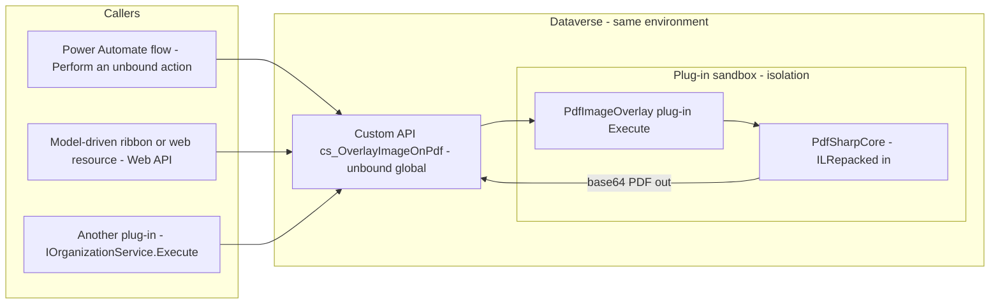
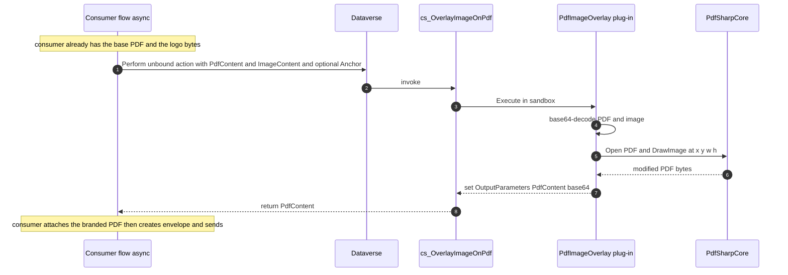

# PdfImageOverlay — a reusable "stamp an image onto a PDF" Dataverse plugin

> **Status: IMPLEMENTED & DEPLOYED TO DEV (dev-ec-esign-01), packaged as the unmanaged solution
> `PdfImageOverlay`** (unpacked at `solutions/PdfImageOverlay/`; export managed to distribute).
> The **active engine is A (iText, `cs_OverlayImageOnPdfX`)**; the dependency-free engine B
> (`cs_OverlayImageOnPdf`) is **parked** — see [Two engines](#two-engines--which-to-use).
> Plugin source: `plugins/CSPdfImageOverlay/` (publisher `cs`).

A small, **schema-agnostic, fully in-platform** capability: a Dataverse **Custom API** that takes a
**PDF + an image** (and optional position / size) and returns a **new PDF with the image stamped
on it**. No Azure, no custom connector, no premium licence — it runs server-side in the Dataverse
plug-in sandbox.

It ships in its own solution (publisher `cs`) and is reusable by any project (e-signature
branding, watermarking, logos, signatures, etc.). The e-signature / political-party use case is
just **one consumer** of it (see [Consumers](#consumers) and the separate web-resource plan).

## Two engines — which to use

> **Delivered / active engine: A — `cs_OverlayImageOnPdfX` (iText).** It handles any PDF + any
> image and is the one the party-logo feature should call.
>
> **Engine B — `cs_OverlayImageOnPdf` (native, dependency-free) is PARKED.** It is deployed in dev
> and its code is in the repo, but it is **not the active path** — it's documented here as a
> *separate alternative we can choose to tackle later* (e.g. to drop the AGPL iText dependency). It
> works only on classic-xref PDFs, which our pdf-lib templates are not, so it is not production-ready
> for this use case without the optional template-generation change noted below.

Both Custom APIs share the **identical parameter contract** (below), so you can compare:

| | `cs_OverlayImageOnPdf` (B — native) | `cs_OverlayImageOnPdfX` (A — iText) |
|---|---|---|
| **Dependencies** | **None** (dependency-free, incremental-update PDF writer) | iText7 7.1.18 (bundled in the plug-in package) |
| **Licence** | MIT-style (our code only) | **AGPL** — fine here: internal Crown-owned use, not redistributed |
| **PDF support** | **Classic cross-reference tables only** — rejects xref-/object-stream PDFs | **Any** PDF (incl. xref streams, the format `pdf-lib` emits) |
| **Image support** | JPEG + **opaque** 8-bit grayscale/RGB PNG | **Any** JPEG/PNG incl. **transparency**, palette, interlaced |
| **Verified** | ✅ correct on classic-xref PDFs | ✅ works on the real templates + party logos |
| **Best for** | lightweight, no third-party code, when you control the PDF format | the current use case — our templates are pdf-lib **xref-stream** PDFs |

**Recommendation for the party-logo use case: use `cs_OverlayImageOnPdfX` (A).** Our template
PDFs are generated by pdf-lib as xref-*stream* PDFs, which the native engine (B) deliberately
rejects (with a message pointing you to A). B is the right choice only for classic-xref PDFs
(e.g. if template generation is switched to `save({useObjectStreams:false})`).

---

## Contents
- [Why a plugin / Custom API](#why-a-plugin--custom-api)
- [Architecture](#architecture)
- [Sequence (flow invocation)](#sequence-flow-invocation)
- [The Custom API](#the-custom-apis-cs_overlayimageonpdf-b-and-cs_overlayimageonpdfx-a)
- [Parameters & defaults](#parameters--defaults)
- [Example usage](#example-usage)
- [Libraries and why each is needed](#libraries-and-why-each-is-needed)
- [The "three stubs", in the new split design](#the-three-stubs-in-the-new-split-design)
- [Build & package](#build--package)
- [Install guide](#install-guide)
- [Solution information page](#solution-information-page)
- [Versioning & distribution (as a product)](#versioning--distribution-as-a-product)
- [Testing](#testing)
- [Limits & sandbox constraints](#limits--sandbox-constraints)
- [Consumers](#consumers)
- [Annex A — full plugin source](#annex-a--full-plugin-source)
- [Annex B — Custom API definition & registration](#annex-b--custom-api-definition--registration)
- [Annex C — solution information page (sample HTML)](#annex-c--solution-information-page-sample-html)

---

## Why a plugin / Custom API
- **In-platform:** runs inside Dataverse. No Azure Function, no hosting, no custom-connector
  licence. PDF manipulation can't be done in a vanilla cloud flow, and Power Automate has no
  Node runtime, so the overlay logic lives in **C#** (the equivalent of the `pdf-lib` call).
- **Reusable:** exposed as an **unbound Custom API** that takes/returns base64 strings — it touches
  no tables and knows nothing about e-signatures or PPEP. Any flow, plug-in, or web resource can
  call it.
- **Portable:** shipped as its own **managed** solution → import once per environment.

---

## Architecture



The plug-in is a pure function: **`(pdfBase64, imageBase64, position?, size?) → pdfBase64`**. It
makes **no Dataverse reads/writes**, so it's safe, fast, and reusable.

---

## Sequence (flow invocation)

Here the consumer is the e-signature flow, but the Custom API part is identical for any caller.



---

## The Custom APIs: `cs_OverlayImageOnPdf` (B) and `cs_OverlayImageOnPdfX` (A)

| | |
|---|---|
| **Unique names** | `cs_OverlayImageOnPdf` (native engine B) · `cs_OverlayImageOnPdfX` (iText engine A) |
| **Binding** | **Unbound** (global) — not tied to any table |
| **Backed by** | `CSPdfImageOverlay.PdfImageOverlayNative` / `…PdfImageOverlayIText` |
| **Execute privilege** | None required beyond calling it (it reads/writes no data) |
| **Allowed callers** | Flows (Dataverse connector), JS web resources (Web API), other plug-ins |

Both take the **identical** parameters below. Pick the engine per [Two engines](#two-engines--which-to-use).

### Parameters & defaults

**Request parameters**

| Name | Type | Required | Default | Description |
|---|---|---|---|---|
| `PdfContent` | String | **Yes** | — | Base64 of the source PDF. |
| `ImageContent` | String | **Yes** | — | Base64 of the image to stamp (**PNG or JPEG**). |
| `Anchor` | String | No | `TopRight` | One of `TopRight`, `TopLeft`, `BottomRight`, `BottomLeft`, `Center`. Ignored if `X`+`Y` are supplied. |
| `X` | Decimal | No | — | Explicit left position in **PDF points, top-left origin**. Overrides `Anchor` when `X`+`Y` both given. |
| `Y` | Decimal | No | — | Explicit top position (points, top-left origin). |
| `Width` | Decimal | No | auto | Target width (points). If only `Width` given, height is derived to keep aspect. |
| `Height` | Decimal | No | auto | Target height (points). If only `Height` given, width is derived to keep aspect. |
| `Margin` | Decimal | No | `24` | Edge margin (points) used for anchored placement. |
| `Page` | Integer | No | `1` | 1-based page to stamp. `0` = **every page**. |

**Response parameters**

| Name | Type | Description |
|---|---|---|
| `PdfContent` | String | Base64 of the resulting PDF (image stamped in). |

### Default behaviour (no position/size given)
- **Position:** top-right corner, `Margin` = 24 pt from the top and right edges.
- **Size:** fit the image inside a box of `clamp(12% of page width, 48pt, 120pt)`, preserving
  aspect ratio. On a 612×792 (US Letter) page that's a ~73 pt box — a sensible logo size.
- **Page:** page 1 only.

Everything is overridable; pass `Anchor`, or exact `X`/`Y`, and `Width`/`Height` to control it.

---

## Example usage

### 1. Power Automate (recommended — "flow invocation")
Add a **Dataverse → "Perform an unbound action"** step:
- **Action Name:** `cs_OverlayImageOnPdf`
- **Parameters (advanced / raw):**
```json
{
  "PdfContent":   "@{outputs('Get_template_PDF')?['body/documentbody']}",
  "ImageContent": "@{base64(body('Download_party_logo'))}",
  "Anchor":       "TopRight"
}
```
- Read the result from `outputs('Perform_an_unbound_action')?['body/PdfContent']`.

### 2. Web API (JS web resource / anywhere)
```http
POST [org]/api/data/v9.2/cs_OverlayImageOnPdf
Content-Type: application/json

{ "PdfContent": "<base64 pdf>", "ImageContent": "<base64 png>", "Anchor": "TopRight" }
```
Response: `{ "PdfContent": "<base64 pdf>" }`.

### 3. Exact placement + custom size
```json
{ "PdfContent":"…","ImageContent":"…","X":430,"Y":30,"Width":120,"Height":40,"Page":1 }
```

### 4. Stamp every page (e.g. a watermark)
```json
{ "PdfContent":"…","ImageContent":"…","Anchor":"Center","Page":0 }
```

---

## Libraries and why each is needed

| Library | Used by | Why |
|---|---|---|
| **Microsoft.CrmSdk.CoreAssemblies** | both | `IPlugin`, `IPluginExecutionContext`, `InputParameters`/`OutputParameters` — the Custom-API plumbing. |
| **itext7 7.1.18** | engine **A** only | Opens any PDF and stamps the image (`PdfCanvas.AddImage`). **Strong-named + native net462** with few, also-strong-named deps (BouncyCastle), so it loads in the sandbox as a **plug-in-package dependency — no ILRepack needed**. AGPL. |
| *(none)* | engine **B** | The native engine writes the PDF incremental update by hand — **no third-party library at all**. |

**Why not PdfSharpCore:** it's a *netstandard2.0*, **unsigned** library that drags SixLabors +
~100 System.* facade assemblies. The net462 sandbox requires strong-named dependencies and chokes
on the facade pile, so it won't load. iText7 (net462-native, strong-named, minimal deps) is the
clean library choice; the dependency-free engine avoids the question entirely.

---

## The "three stubs", in the new split design

The earlier `SendBrandedEnvelopePlugin.cs` had three stubs. With the **agnostic split** they now
live in two places:

| Former stub | Where it lives now | What it does |
|---|---|---|
| **`CompositeLogo`** | **This plug-in** (`PdfImageOverlay.Overlay`) — fully implemented in [Annex A](#annex-a--full-plugin-source) | The only real work: decode PDF+image, compute position/size (anchor/explicit), `DrawImage`, return bytes. Generalised with `Anchor/X/Y/Width/Height/Margin/Page`. |
| **`DownloadFileColumn`** | **Consumer** (the e-sign flow / web resource) | Reads the party logo from `pfa_politicalparty.pfa_logo` (Image column) — `GET pfa_politicalparties(id)/pfa_logo/$value?size=full`. Not the generic plug-in's concern. |
| **`ParseSignerLabels`** | **Consumer** (the e-sign flow / web resource) | Reads `cs_templatejson.signers[].label` to map recipients. Not the generic plug-in's concern. |

This keeps the product a clean, reusable **PDF function**; all e-signature/PPEP specifics are in the
consumer layer.

---

## Build & package (as actually done)
Project: `plugins/CSPdfImageOverlay/` — scaffolded with **`pac plugin init`** (net462,
strong-named via the generated `.snk`, `Microsoft.NETFramework.ReferenceAssemblies` so it builds
cross-platform). One assembly holds both engines (`OverlayBase`, `PdfImageOverlayNative`,
`PdfImageOverlayIText`) + the `itext7` package reference.

```bash
cd plugins/CSPdfImageOverlay
dotnet build -c Release          # -> bin/Release/cs_PdfImageOverlay.1.0.0.nupkg (plug-in package)
```

- The NuGet **PackageId must carry the publisher prefix** (`cs_PdfImageOverlay`) or Dataverse
  rejects it ("nuget file name does not contain a solution prefix").
- **Register the plug-in package** (first time) by creating a `pluginpackage` row via the Web API
  with the `.nupkg` as base64 `content` (Dataverse unpacks it → `pluginassembly` + `plugintype`
  per `IPlugin`). Thereafter `pac plugin push --type Nuget --pluginId <pluginpackageid>` updates it.
- **Create the two Custom APIs** (`cs_OverlayImageOnPdf` → `…Native`, `cs_OverlayImageOnPdfX` →
  `…IText`) with the parameters in [Annex B](#annex-b--custom-api-definition--registration), each
  bound to its plug-in type. Isolation is **Sandbox** (automatic for the package model).
- **No ILRepack, no strong-name signing of deps** — the package model carries iText7 (already
  strong-named); the native engine has no deps.

---

## Install guide
1. Import `PdfImageOverlay_x_y_z_managed.zip` into the target environment.
2. Open the solution → the **Information page** (Annex C) summarises the Custom API, parameters and
   examples for the installer.
3. The Custom API `cs_OverlayImageOnPdf` is immediately callable from flows, web resources, or
   other plug-ins. No configuration records required.
4. (Optional) Grant the relevant security role the privilege to call the Custom API if you lock it
   down; by default any authenticated caller in the org can invoke it (it reads/writes no data).

---

## Solution information page
Managed solutions don't pop a readme on import, so the "info page the installer reads" is shipped as
an **HTML web resource** (`cs_/pdfoverlay/about.html`, [Annex C](#annex-c--solution-information-page-sample-html))
plus the **Solution Description** field. The page covers: what the Custom API does, the parameter
table, default position/size, a copy-paste flow example, the version, and support contact. You can
surface it via a one-page model-driven app (an "About" area) or just open the web resource URL; its
link goes in the Solution Description so it's discoverable from the Solutions list.

---

## Versioning & distribution (as a product)
- Ship **managed** for distribution; keep an unmanaged dev solution for source.
- Semantic solution version (e.g. `1.0.0.0`); bump on every release; the info page shows the version.
- Publisher prefix is yours (`ec`); the Custom API name carries it, so it won't clash.
- Promote dev → test → prod by exporting managed and importing; no data/config to migrate.

---

## Testing
- **Offline unit test** the `Overlay` method: feed a sample PDF + PNG/JPEG, assert the output opens
  and the image lands at the expected rectangle for each `Anchor` and for explicit `X/Y`.
- **In-env:** call `cs_OverlayImageOnPdf` from a scratch flow with a template PDF + a party logo;
  download the `PdfContent` and eyeball it. The Node sample
  `solutions/docs/sample-create-partylogo-envelope.mjs` is the visual reference for the default
  top-right placement.

---

## Limits & sandbox constraints
- **Sandbox isolation:** no filesystem, **no `System.Drawing`/GDI**, approved managed APIs only,
  ~2-minute execution cap. Both engines comply (iText7 is net462-native + strong-named; the native
  engine has no deps). Run the step **async** for large PDFs.
- **Engine B (native):** classic cross-reference **tables only** — rejects xref-/object-stream PDFs
  (incl. pdf-lib output) with a message pointing to engine A; also assumes the page's `/Resources`
  is inline. Images: JPEG + opaque 8-bit grayscale/RGB PNG (no transparency/palette/interlace).
- **Engine A (iText):** handles any PDF + any image; **AGPL** (acceptable here — internal
  Crown-owned, not redistributed).
- **Message size:** base64 PDFs travel in the action payload; very large PDFs increase memory/time —
  prefer async and reasonable document sizes.

---

## Consumers
This product is generic. The **e-signature / political-party** consumer (separate from this solution)
does:
1. Read the registered party's logo from **`pfa_politicalparty.pfa_logo`** (Image column) —
   `GET …/pfa_politicalparties(<id>)/pfa_logo/$value?size=full`.
2. Read the chosen `cs_template`'s `TemplateSourcePDF` + `cs_templatejson`.
3. Call **`cs_OverlayImageOnPdf`** (PDF = template PDF, Image = party logo) → branded PDF.
4. Create `cs_envelope` + `EnvelopeSourcePDF` + signers, set `cs_adhocsend = true`.
5. Broker `ESign - Send Ad-hoc Envelope` (unchanged) submits to Nintex.

Two consumer front-ends:
- **Flow** (answer #2 — flow invocation): the canonical headless path.
- **Model-driven ribbon button + JS web resource** for backend users — see the separate plan
  `solutions/docs/branded-esign-webresource-plan.md`.

---

## Annex A — source

The full, deployed source lives in the repo (authoritative — this annex no longer duplicates it):

- `plugins/CSPdfImageOverlay/OverlayBase.cs` — shared Custom-API plumbing + `Fit()` size/anchor math.
- `plugins/CSPdfImageOverlay/PdfImageOverlayNative.cs` — **engine B** (`cs_OverlayImageOnPdf`): dependency-free incremental-update PDF stamper. Finds the `/Page`, decodes JPEG (`DCTDecode`) / opaque 8-bit PNG (`FlateDecode` + PNG predictor), appends an image XObject + content stream, rewrites the page's `/Contents`+`/Resources`, and writes an incremental `xref`/trailer with `/Prev`.
- `plugins/CSPdfImageOverlay/PdfImageOverlayIText.cs` — **engine A** (`cs_OverlayImageOnPdfX`): `PdfReader`+`PdfWriter`, `ImageDataFactory.Create`, `PdfCanvas.AddImage` (CTM form; iText origin is bottom-left so `y = pageH - top - h`).
- `plugins/CSPdfImageOverlay/CSPdfImageOverlay.csproj` — net462, `itext7` 7.1.18, PackageId `cs_PdfImageOverlay`.

Both engines share the parameter contract via `OverlayBase`; only `Overlay(pdf, img, opts)` differs.
## Annex B — Custom API definition & registration

Create one **Custom API** (`customapi`) + its parameters (via maker portal, `pac`, or import):

**Custom API**
- Unique Name: `cs_OverlayImageOnPdf` · Name: `Overlay Image On PDF`
- Binding Type: **Global** (unbound) · Is Function: **No** (it's an Action — has side-effect-free output but we use Action semantics)
- Allowed Custom Processing Step Type: **None** (logic is the main plug-in) · Is Private: **No**
- Plugin Type: `EC.Pdf.Plugins.PdfImageOverlay`

**Request parameters** (`customapirequestparameter`)

| UniqueName | Name | Type | IsOptional |
|---|---|---|---|
| `PdfContent` | Pdf Content | String | No |
| `ImageContent` | Image Content | String | No |
| `Anchor` | Anchor | String | Yes |
| `X` | X | Float | Yes |
| `Y` | Y | Float | Yes |
| `Width` | Width | Float | Yes |
| `Height` | Height | Float | Yes |
| `Margin` | Margin | Float | Yes |
| `Page` | Page | Integer | Yes |

**Response properties** (`customapiresponseproperty`)

| UniqueName | Name | Type |
|---|---|---|
| `PdfContent` | Pdf Content | String |

Registration: assembly **Sandbox / Database**, strong-named, ILRepacked. The Custom API binds the
plug-in as its main operation (no separate SDK step needed when the Custom API's Plugin Type is set).

---

## Annex C — solution information page (sample HTML)

Ship as web resource `cs_/pdfoverlay/about.html` and link it from the Solution Description.

```html
<!doctype html><html><head><meta charset="utf-8"><title>PDF Image Overlay</title>
<style>body{font:14px/1.5 Segoe UI,Arial;margin:24px;max-width:820px;color:#1c272e}
code,pre{background:#f4f5f7;border-radius:4px}pre{padding:12px;overflow:auto}
h1{color:#1e384b}table{border-collapse:collapse}td,th{border:1px solid #e3e7ec;padding:6px 10px}</style>
</head><body>
<h1>PDF Image Overlay <small>v1.0.0.0</small></h1>
<p>Stamps an image onto a PDF and returns a new PDF. Server-side, in-platform, no Azure.</p>
<h2>Custom API: <code>cs_OverlayImageOnPdf</code> (unbound)</h2>
<p><b>Required:</b> <code>PdfContent</code> (base64 PDF), <code>ImageContent</code> (base64 PNG/JPEG).<br>
<b>Optional:</b> <code>Anchor</code> (TopRight default), <code>X</code>,<code>Y</code>,
<code>Width</code>,<code>Height</code>,<code>Margin</code> (24), <code>Page</code> (1; 0=all).<br>
<b>Returns:</b> <code>PdfContent</code> (base64 PDF).</p>
<p><b>Default placement:</b> top-right, 24&nbsp;pt margin, size fit to ~12% of page width.</p>
<h2>Call from a flow</h2>
<pre>Dataverse → Perform an unbound action → cs_OverlayImageOnPdf
{ "PdfContent": "&lt;base64&gt;", "ImageContent": "&lt;base64&gt;", "Anchor": "TopRight" }</pre>
<p>Support: your-team@elections.ca</p>
</body></html>
```
